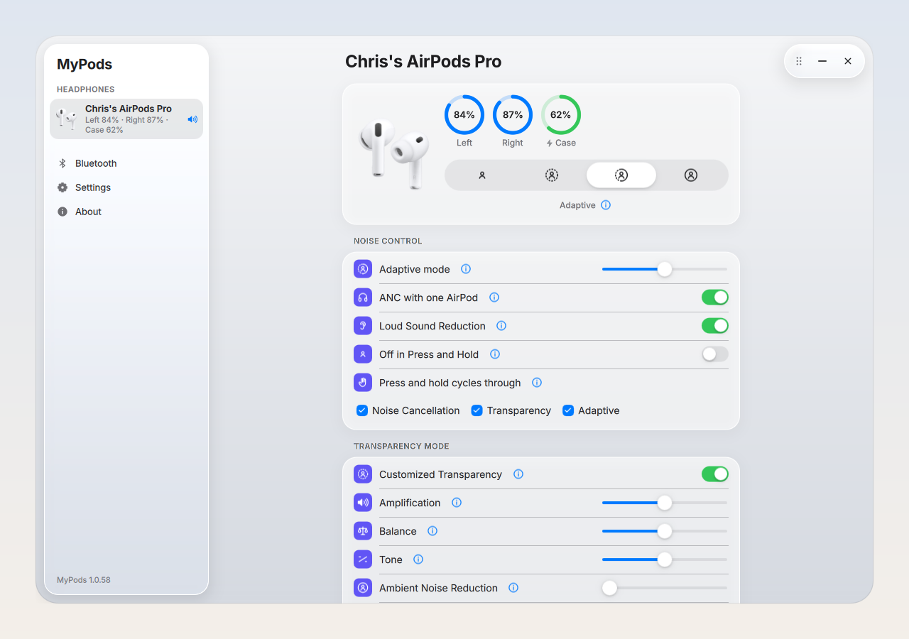
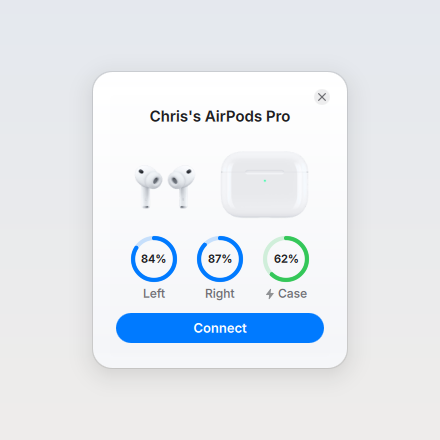
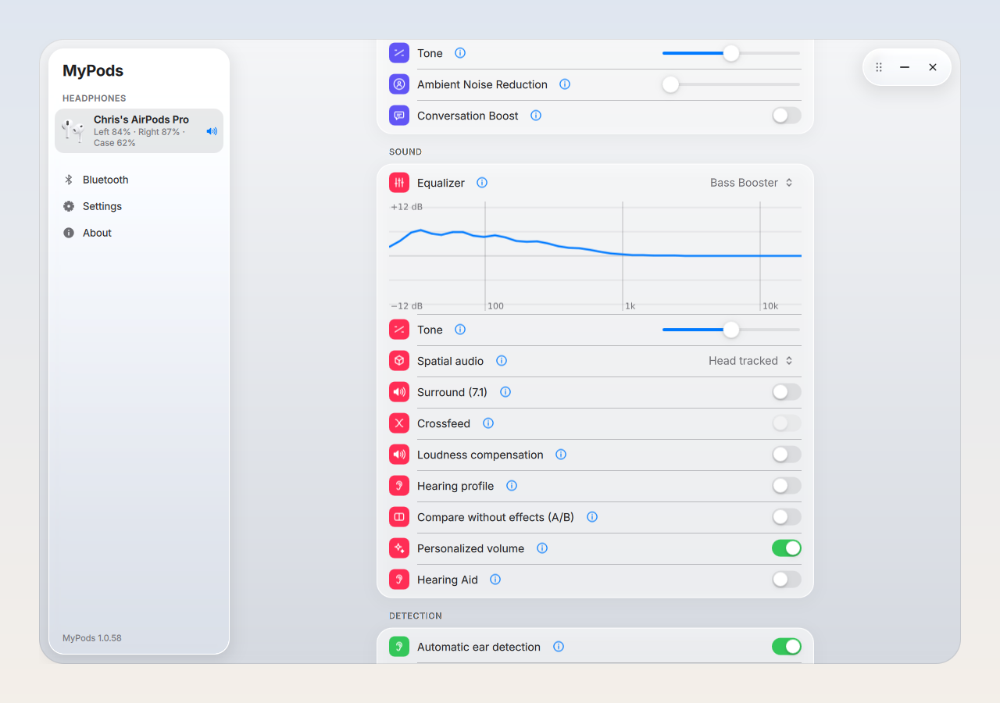
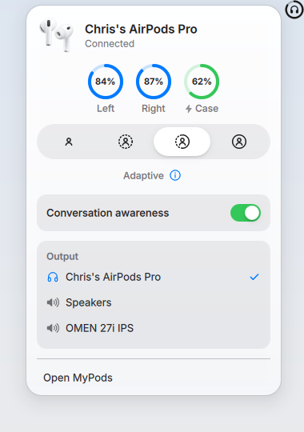
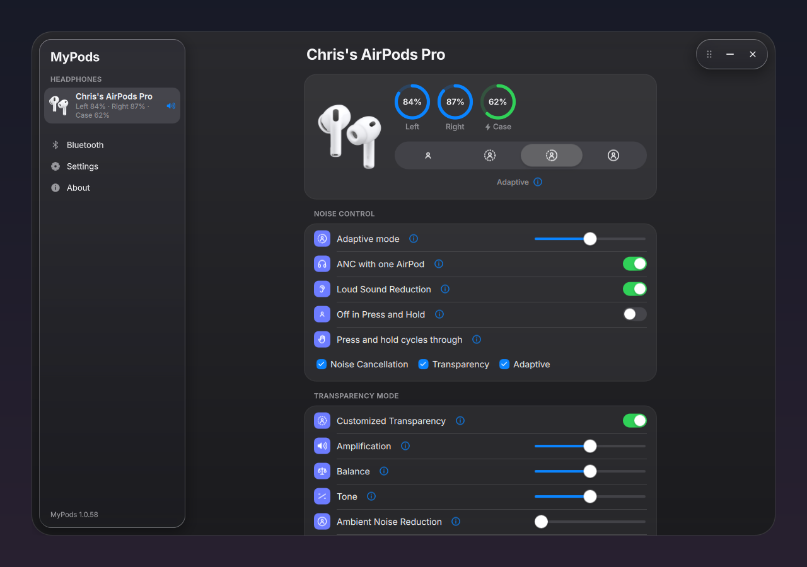

<div align="center">

# MyPods

### AirPods magic. Now on Linux.

Open the case next to your computer and the battery is already on screen.<br>
AirPods the way they behave on a Mac, on Linux and Windows. For AirPods, Beats and most other Bluetooth headphones.

<br>

[](LICENSE)


<br>



</div>

> [!NOTE]
> MyPods is a personal project in active development, running on CachyOS (Arch-based). It has been tested with
> AirPods Max and Parrot Zik 2.0. AirPods Pro 3 support comes from protocol research and has not been tested on
> real hardware yet, and neither have the other models listed below. Features marked *unverified* fall into the
> same category.

> [!WARNING]
> **This project is vibe-coded.** Large parts of the new code were written with an AI coding assistant and
> reviewed by hand, on top of the existing MagicPods code base. Expect rough edges, and read the code before you
> rely on it.

<br>

Contents: [Features](#lid-open-there-they-are) · [Devices](#not-just-airpods) · [How it works](#how-it-works) · [Tech specs](#tech-specs) · [Install](#download-install-done) · [Windows](#windows-too) · [Setup](#set-it-up-once-switch-from-then-on) · [Usage](#using-mypods) · [Configuration](#fine-tuning-in-configtoml) · [Building](#build-it-yourself) · [Testing](#tested-again-and-again) · [API](#for-developers-the-api) · [Limitations](#what-doesnt-work-yet) · [Troubleshooting](#when-somethings-off) · [Security](#security-and-privacy) · [Credits](#credits-and-license)

<br>

## Lid open. There they are.

<div align="center">



</div>

Open the case near your computer and the popup you know from the Mac appears, with the animation and the battery of the left and right AirPod and the case. MyPods reads the BLE advertisements AirPods broadcast all the time, so the popup shows up before the AirPods are even connected. Connect in the popup connects them and puts the sound on the AirPods.

<br>

## Every percent counts.

MyPods shows the battery of the left and right AirPod and the case in 1 % steps, with the charging state. It decrypts the level from the advertisement and also reads it over AAP. The tray icon draws it as a ring that turns red at 20 % and below while nothing charges. Hover over the icon and, after a while, the tooltip also says roughly how long the battery will last.

When an AirPod or the Max drops to 10 %, you get a desktop notification. It comes back only after charging or once the level is above 20 %. On Linux, MyPods hands the exact level to BlueZ, so the desktop's Bluetooth applet and UPower show it too.

<br>

## Silence. Or the world.

Off, Transparency, Adaptive and Noise Cancellation, plus the slider for the adaptive level from 0 to 100. You choose which modes a press and hold cycles through and whether Off is one of them, and you can turn on noise cancellation with a single AirPod in.

AirPods Pro 2 and 3 add Loud Sound Reduction and customized transparency (amplification, balance, tone, ambient noise reduction, conversation boost), which MyPods writes over the AirPods' ATT channel. *Unverified on hardware.*

Conversation Awareness lowers the volume to 30 % of its level while you speak (adjustable) and brings it back afterwards. MyPods shows whether it is kicking in right now.

<br>

## From iPhone to laptop. And back.

When a player starts on the computer (a browser, Spotify, anything with MPRIS), MyPods takes the AirPods over from your iPhone. It connects them if needed, performs Apple's smart routing handoff, enables A2DP and makes them the default output. When the iPhone starts playing, the computer pauses and falls back to its speakers. It never takes over during a call on the other device. On a Mac this is "Connect to This Mac: Automatically".

While you wear the AirPods and another device has them, the speakers stay silent: what plays here goes to a silent output until the AirPods play it. Take them out or pick an output to get the speakers back. The iPhone's banner names this computer by its Bluetooth name.

When the AirPods are playing on the iPhone, the device page says "Playing on iPhone" and offers Move here. If you'd rather switch by hand, choose "When Last Connected to This Computer".

On Linux this needs BlueZ to present itself as an Apple device once, see [Setup](#set-it-up-once-switch-from-then-on).

<br>

## Take one out. The music waits.

Taking an AirPod out pauses playback and putting it back resumes it, through MPRIS. The AirPods store this switch themselves. Sleep detection and the Digital Crown direction (AirPods Max) are there for the models that report them.

<br>

## Your AirPods. Your way.

MyPods writes these settings to the AirPods, for the models that report them: press speed, press and hold duration, volume swipe and its length, tone volume, personalized volume, mute and end call, and which microphone is used (automatic, always left, always right).

A new name is stored on the AirPods themselves, so every paired device sees it. The model number, serial number and firmware are in the Device section of the device page.

With several headphones connected, MyPods controls the ones connected last. Pick others in the sidebar and the tray and popup follow.

<br>

## Sounds like you.

<div align="center">



</div>

The equalizer has the Apple Music presets (Acoustic, Bass Booster, Classical, Rock, Vocal Booster and the rest) or ten bands you set by hand ("Manual"). It never clips, and the curve below it shows what it does to the frequency response. Around it:

- Tone: one slider makes the whole sound warmer or brighter, the bass down and the treble up (or the other way round) by up to 6 dB each, while 1 kHz stays put.
- Headphone correction with measured [AutoEQ](https://github.com/jaakkopasanen/AutoEq) filters that bring the model to the Harman target, for AirPods 1 to 4, Pro, Pro 2, Max and most Beats. Pro 3 and Max 2 are missing because nobody has measured them yet.
- Your own correction: an AutoEQ or Equalizer APO `ParametricEQ.txt` (setting `eqFile`) replaces the built-in one, for your own measurement, another target, or a model nobody measured.
- Crossfeed in the style of bs2b, for stereo music without spatial audio. Each ear also hears a bit of the other channel's bass, as with speakers. Mono stays untouched.
- Loudness compensation (ISO 226) brings the bass back the quieter you listen, following the volume live.
- A hearing profile turns an audiogram per ear (six thresholds from 250 Hz to 8 kHz) into a separate EQ for each ear, with the half-gain rule and at most 20 dB. Apple calls its version Headphone Accommodations.
- "Compare without effects (A/B)" switches every effect off but keeps the pre-gain, so both sides play equally loud and louder never passes for better.
- A lookahead limiter at the end of the chain (with `swh-plugins`) lets spatial audio play 7 dB louder, and head turns past 45° stop clipping. Measured: a −1.0 dBFS peak where the chain without it reached +0.9 dBFS.
- The Hearing Aid switch, once the hearing test has been set up on an iPhone.

<br>

## Sound all around you.

Spatial audio comes off, fixed or head tracked. A PipeWire filter chain with an HRTF (libmysofa) places the sound in the room, equalized so centered sound stays neutral (within 0.75 dB from 31 Hz to 8 kHz, measured). The head orientation streams from the AirPods.

For films there is "Surround (7.1)", MyPods' answer to Spatial Audio with Dolby Atmos. The chain takes 5.1 and 7.1 and places seven virtual speakers in the ITU layout, with the sides at 90° and the rears at 135°, all of them head tracked. The LFE goes to both ears, and PipeWire upmixes stereo players.

<br>

## Honest down to the last bit.

Lossless and Hi-Res as in Apple Music don't exist over Bluetooth: AirPods speak only AAC, which is lossy. Instead, MyPods has a signal path display on the device page that says whether what plays arrives bit-perfect, and if not, why. Hi-Res playback lets wired headphones and USB DACs play at the source's rate up to 192 kHz. Highest Bluetooth quality sets AAC to its best variable bitrate and LDAC to 990 kbit/s (details under [Bluetooth sound quality](#bluetooth-sound-quality)). The device page also shows the active codec.

<br>

## One click. And it plays there.

Click headphones in the sidebar and they become the ones you control, with the sound going to them. A small speaker symbol marks where the sound plays right now. If you switch the output in the taskbar or in the desktop's sound settings, MyPods follows.

The tray popup lists every output under Output, speakers and monitors included, with a check mark on the one playing. Headphones take their effects along when you switch. For headphones on a monitor's jack, mark the output once under *Settings > Headphones on these outputs*, because monitors don't tell anyone whether something is plugged in. From then on they are headphones like any other pair, with their own equalizer.

<br>

## All in the menu bar.

<div align="center">



</div>

Clicking the tray icon opens a popup right under the panel, much like the AirPods module in the Mac's Control Center. It has the battery, noise control, Conversation Awareness, Move here, what's playing with play, pause and skip, the volume and the output list. A double click opens the full window.

<br>

## Your iPhone plays along.

While the iPhone plays to its own headphones, the tray popup shows and controls what's on it: title, artist, cover, play, pause and skip, Apple Music's star (favorite) and the iPhone's volume in its 16 steps, marked "Playing on <iPhone>". It works over the Apple Media Service (BLE), the same service an Apple Watch uses. The cover comes from the iTunes Search API, which gets the artist and title. The Bluetooth page lists the paired iPhones and whether they are connected.

<br>

## Light. Or dark.

<div align="center">



</div>

The sidebar, popups and menus are glass panes over the content, in the style of Apple's Liquid Glass. The appearance is light, dark or follows the system, and the tray icon has its own setting. An (i) beside every setting explains what it does. The UI speaks English and German (Qt Linguist).

There is also autostart, a Steam Deck and gamescope mode inherited from MagicPods, and a diagnostics section under About with the logs, the state of Equalizer APO (Windows) and the iPhone.

<br>

## Your keys. Your rules.

`mypods --action <name>` changes the connected headphones through the daemon and exits, without opening a window. Bind it to a key in your desktop's shortcut settings (KDE: *System Settings > Keyboard > Shortcuts > Add New > Command*, GNOME: *Settings > Keyboard > Custom Shortcuts*). It works on X11 and Wayland alike.

| Action | Does |
|--------|------|
| `noise-next` | Next noise control mode the headphones offer |
| `noise-off`, `noise-anc`, `noise-transparency`, `noise-adaptive` | That noise control mode |
| `conversation-awareness` | Conversation Awareness on/off |
| `move-here` | Take the AirPods over from the iPhone ("Move here") |
| `eq-next` | Next equalizer preset |
| `effects-bypass` | Compare with and without effects (A/B) on/off |
| `output-next` | Play on the next output (speakers, monitor, headphones), with or without headphones connected |

It exits with status 1 and a message when the daemon isn't running or the headphones can't do it. On Windows, MyPods brings its own shortcuts, see [Windows](#windows-too).

<br>

## Not just AirPods.

### Parrot Zik 2.0

MyPods controls it through the headphones' own RFCOMM XML API. Pair it and MyPods recognizes it by its service UUID.

- Battery level and charging state
- Noise control: ANC and Street Mode, each in normal or max strength. There is no Off, because Off mutes the Zik 2.
- Head detection (auto-pause)
- The Concert Hall effect with room size (silent, living, jazz, concert) and angle (30° to 180°)
- An equalizer on the headphones' DSP, with the same presets as the AirPods equalizer or your own setting of its 5 bands ("Custom"), stored in the headphones
- Smart Audio Tune, ANC during phone calls, voice prompts, auto connection and auto power off

### Samsung Galaxy Buds

Battery and noise control, inherited from MagicPodsCore (Galaxy Buds, Buds+, Live, Pro, Buds2, Buds2 Pro, FE, Core, Buds3, Buds3 Pro, Buds3 FE, Buds4, Buds4 Pro), plus ear detection: taking a bud out pauses and putting it back resumes. The switch is stored locally, and the Buds Core don't have it.

### Beoplay E8 (1st generation)

On Windows, MyPods reads the device information and the transparency state over Bluetooth LE. What the E8 reveals is written up in [docs/beoplay-e8.md](docs/beoplay-e8.md).

### Any other headset

Any paired device with the Hands-Free profile (or A2DP only) shows its battery when it reports one through HFP, and the active Bluetooth codec. It also gets the effects that run on this computer: equalizer, tone, crossfeed, loudness, hearing profile, a headphone correction from your own `ParametricEQ.txt` (`eqFile`) and, on Linux, spatial audio without head tracking and the signal path. Wired headphones on a jack or USB get the same, as do outputs marked as headphones (a monitor's jack).

### Supported devices

| Family | Models | Status |
|--------|--------|--------|
| AirPods Max | Max (`0x200A`), Max USB-C (`0x201F`), Max 2 (`0x202D`) | Tested (AirPods Max). The Max 2 popup trigger is *unverified*. |
| AirPods Pro | AirPods Pro 3 (A3063 / A3064 / A3065, model ID `0x2027`) | Implemented, *not tested on hardware* |
| Other AirPods | AirPods 1 to 4, AirPods 4 ANC, AirPods Pro, Pro 2, Pro 2 USB-C | Recognized by the inherited AAP stack, not tested by this project |
| Beats | Powerbeats Pro / Pro 2 / 3 / 4 / Fit, Beats Fit Pro, Studio Buds / Buds+, Studio Pro, Studio 3, Solo 3 / Pro / 4 / Buds, Flex, BeatsX | Recognized by the inherited AAP stack, not tested by this project |
| Parrot | Zik 2.0 | Tested |
| Samsung | Galaxy Buds series (see above) | Inherited from MagicPodsCore, not tested by this project |
| Bang & Olufsen | Beoplay E8 (1st generation) | Device information and transparency state, Windows only |
| Generic | Any Hands-Free (HFP) or A2DP headset, wired headphones | Battery (when reported), codec, effects on this computer |

Linux gets every feature. Windows gets the part that works without a kernel driver, see [Windows](#windows-too).

<br>

## How it works.

Apple headphones talk to their host over two separate channels, and most tools only use one of them. MyPods uses both.

```
                 ┌──────────────────────── AirPods ────────────────────────┐
                 │                                                         │
   BLE advertisements (Continuity,                     L2CAP, PSM 0x1001
   "Proximity Pairing", type 0x07)                     (AAP / "AACP")
   no connection needed                                needs a classic connection
                 │                                                         │
                 ▼                                                         ▼
 ┌───────────────────────────────── mypodscore (daemon) ─────────────────────────────────┐
 │  lid state, coarse battery,       │  exact battery, ANC, ear detection, settings,       │
 │  AES-decrypted exact battery,     │  IRK/ENC key exchange, smart routing (handoff),     │
 │  RPA check → popup trigger        │  head tracking                                      │
 │                                                                                          │
 │  BlueZ (D-Bus) · PulseAudio/PipeWire · MPRIS (D-Bus) · PipeWire filter chain (EQ, HRTF)  │
 │  settings in ~/.config/mypods/config.toml                                                │
 └───────────────────────────────────────┬──────────────────────────────────────────────────┘
                                         │ WebSocket, JSON, port 2020
                                         ▼
                        ┌──────── mypods (Qt 6 / QML UI) ────────┐
                        │ tray icon, device pages, settings,        │
                        │ lid-open popup animation                  │
                        │ starts the daemon on launch               │
                        └───────────────────────────────────────────┘
```

1. Over BLE, AirPods constantly broadcast Apple manufacturer data (`0x004C`). The Proximity Pairing message contains the model, lid counter, in-ear and in-case bits, coarse battery nibbles and a 16-byte AES-128 encrypted block with the exact battery. That is why the popup appears instantly, even before the AirPods are connected. On Linux the scan pauses while AirPods are connected: AAP then delivers the same information, and the scan's classic inquiry can make A2DP audio stutter.
2. Once connected, the daemon opens an L2CAP socket on PSM `0x1001`, sends the handshake and subscribes to notifications. From then on the AirPods push battery, noise control, ear detection and more, and accept settings changes. If the AirPods close the channel while the Bluetooth link stays up, the daemon opens it again (up to five times per connection). AirPods Pro 2 and 3 keep a few more settings (Loud Sound Reduction, customized transparency) as GATT characteristics, which the daemon reads and writes over a second L2CAP channel (ATT, PSM `0x1F`).
3. To recognize *your* AirPods among rotating BLE addresses (RPA) and to decrypt the battery block, MyPods needs the IRK and ENC key. It asks the AirPods for them over AAP on every connection and stores them when they change. iCloud isn't involved.
4. The AirPods relay Apple's smart routing messages between their sources. MyPods takes part in that exchange and watches MPRIS players to decide when to take over.
5. Equalizer, headphone correction, crossfeed, loudness, hearing profile and spatial audio run as a PipeWire filter chain sink (`mypods_fx`) in front of the headphones: a pre-gain per input channel, then spatial audio or crossfeed, then the filters per ear, then the limiter. The pre-gain takes off exactly as much as the chain can boost (computed from the summed filter curves), so nothing clips. Head tracking and the volume (for the loudness compensation) update the running chain via `pw-cli`. The chain runs at the graph's rate, so with Hi-Res playback at the source's. When PipeWire restarts, the daemon reconnects and puts a new chain in front of the headphones playing then.
6. For the iPhone's now playing, the UI talks to a paired iPhone directly, over the Apple Media Service (AMS), the BLE GATT service an Apple Watch uses for the same thing. The iPhone pushes title, artist, playback state and volume, and takes play/pause, skip and volume steps. On Linux the UI registers a BlueZ LE advertisement that solicits AMS, and the iPhone connects to it; on Windows the UI connects to the iPhone itself. The daemon isn't involved.

A detailed write-up of the protocols and design decisions is in [docs/PLAN.md](docs/PLAN.md) (German).

<br>

## Tech specs

| | |
|---|---|
| Platform | Linux (developed and tested on CachyOS with KDE Plasma) and Windows (MSI, no kernel driver) |
| Interface | Qt 6 / QML with a glass design, light, dark or automatic, English or German |
| AirPods | Lid-open popup, battery in 1 % steps, noise control, ear detection, Conversation Awareness, automatic switching with the iPhone, every setting the AirPods report |
| Sound | Apple Music presets, 10-band EQ, tone, AutoEQ correction, crossfeed, loudness, hearing profile, A/B, limiter |
| Spatial audio | Fixed or head tracked, 7.1 surround, HRTF through libmysofa (Linux) |
| Output | Picked in the sidebar or the tray, signal path, Hi-Res up to 192 kHz (Linux), AAC VBR and LDAC 990 kbit/s |
| iPhone | Now playing, cover, controls and volume over the Apple Media Service |
| Devices | AirPods, Beats, Parrot Zik 2.0, Galaxy Buds, Beoplay E8, any HFP or A2DP headset, wired headphones |
| API | WebSocket JSON API on `127.0.0.1:2020` |
| Based on | MagicPodsCore and MagicPodsLinux, C++20 |
| License | GPL-3.0 |

<br>

## Download. Install. Done.

### AppImage (any distribution)

Download `MyPods-x86_64.AppImage` from the [latest release](https://github.com/HanreichC/MyPods/releases/latest), then run `chmod +x MyPods-x86_64.AppImage && ./MyPods-x86_64.AppImage`. Qt is bundled; BlueZ, PipeWire and libmysofa still come from the host. Every push to `main` is a release (`vX.Y.N`, the version the app shows).
To build it yourself: `podman run --rm -v "$PWD:/workspace:Z" -w /workspace docker.io/library/ubuntu:22.04 ./appimage.sh`

### Arch package

[packaging/arch/PKGBUILD](packaging/arch/PKGBUILD) builds a `mypods-git` package from the latest commit on GitHub (AUR style), not from your local checkout. It installs to `/usr/lib/mypods`, with `mypods` and `mypodscore` in `/usr/bin`, a start menu entry and the daemon's systemd user unit.

```bash
cd packaging/arch && makepkg -si
systemctl --user enable --now mypods-core.service   # once per user

# uninstall
systemctl --user disable --now mypods-core.service
sudo pacman -R mypods-git
```

### From source (Arch-based)

```bash
git clone https://github.com/HanreichC/MyPods.git
cd MyPods
./install.sh
```

`install.sh` builds MyPods in the Podman container and installs it for the current user. No root required.

| What | Where |
|------|-------|
| UI binary | `~/.local/opt/mypods/mypods` |
| Daemon binary | `~/.local/opt/mypods/modules/mypodscore` |
| Start menu entry | `~/.local/share/applications/app.mypods.desktop` |
| Autostart entry (starts hidden in the tray) | `~/.config/autostart/app.mypods.desktop` |
| Daemon as systemd user service | `~/.config/systemd/user/mypods-core.service` |
| Icon | `~/.local/share/icons/mypods.png` |

The daemon runs as a systemd user service, independent of the tray app: ear detection, automatic switching and the effects keep working after you quit the tray app, and systemd restarts the daemon if it crashes. Its log is in `journalctl --user -u mypods-core` and in `~/.local/state/mypods/core.log`. Without systemd (and in the AppImage) the tray app starts the daemon itself. Without a Bluetooth adapter the daemon exits, and systemd (or the tray app) starts it again until one shows up; it uses BlueZ's first adapter, which need not be `hci0`. The same happens when the adapter goes away or bluetoothd restarts or crashes.

Run the script again to update. It stops the running instance, reinstalls and starts it again, and removes what an install from the days MyPods was called MagicPods left behind.

#### Uninstall

```bash
systemctl --user disable --now mypods-core.service
pkill -x mypods; pkill -x mypodscore
rm -rf ~/.local/opt/mypods \
       ~/.local/share/applications/app.mypods.desktop \
       ~/.config/autostart/app.mypods.desktop \
       ~/.config/systemd/user/mypods-core.service \
       ~/.local/share/icons/mypods.png
systemctl --user daemon-reload
rm -rf ~/.config/mypods ~/.local/state/mypods   # optional: settings, stored AirPods keys, logs
```

### Requirements

#### Runtime (host)

- Linux with BlueZ and PipeWire (with `pipewire-pulse`, since the daemon uses libpulse)
- Qt 6.9 or newer: `qt6-base`, `qt6-declarative`, `qt6-websockets`, `qt6-svg`
- `libpulse`, `openssl`, `systemd-libs`
- `libmysofa` (only for spatial audio; the default HRTF is read from `/usr/share/libmysofa/default.sofa`)
- Optional: `swh-plugins` for the lookahead limiter (LADSPA `fast_lookahead_limiter_1913.so`, found in `$LADSPA_PATH` or `/usr/lib/ladspa`). Without it spatial audio plays 7 dB quieter to stay clean.
- An MPRIS-capable media player for auto-pause, automatic switching and the tray popup's now playing (browsers, Spotify, mpv with `mpv-mpris`, …)
- `pactl` (part of `libpulse`) for the tray popup's volume slider
- For the iPhone's now playing: the iPhone paired with this computer, and an adapter with LE advertising. MyPods advertises for the Apple Media Service and the iPhone connects over LE by itself. The pairing must give the LE keys too (the iPhone derives them from a Classic pairing); Intel adapters do, some Realtek adapters and USB dongles don't.
- Optional: `layer-shell-qt` (ships with KDE Plasma) to place the tray popup under the panel on Wayland
- A system tray. KDE Plasma, Cinnamon, XFCE and most panels have one; GNOME needs the *AppIndicator and KStatusNotifierItem Support* extension. Without a tray, MyPods opens as a window and the daemon keeps working in the background.
- For the battery level in the system's Bluetooth settings: a BlueZ with the battery provider API (current versions; older ones need `bluetoothd --experimental`). Everything else works without it.

#### Build

- Podman. The build runs inside a container and nothing is installed on the host.

The container is based on Arch Linux so the binaries match an Arch-based host (Arch, CachyOS, EndeavourOS, …). On other distributions, build natively instead (see [Build it yourself](#build-it-yourself)).

On Arch-based systems, the runtime packages are:

```bash
sudo pacman -S --needed bluez pipewire pipewire-pulse libpulse openssl \
    qt6-base qt6-declarative qt6-websockets qt6-svg libmysofa swh-plugins layer-shell-qt
```

<br>

## Windows too.

Download `MyPods-x64.msi` from the [latest release](https://github.com/HanreichC/MyPods/releases/latest) and install it. It installs to `C:\Program Files\MyPods`, adds a Start menu entry and starts MyPods hidden in the tray at login. Settings live in `%APPDATA%\mypods\config.toml`, the logs in `%LOCALAPPDATA%\MyPods\logs`. When a newer release is out, the About page says so (you can turn this off under *Settings > General > Check for Updates*); the MSI updates in place and ends a running MyPods first.

Windows only lets kernel-mode drivers open L2CAP channels, and every AirPods setting travels over L2CAP (AAP). MyPods ships no Bluetooth driver, so on Windows it does what user space allows:

| Feature | Windows |
|---------|---------|
| Device list, connect/disconnect, Bluetooth on/off | Yes (WinRT, Bluetooth audio driver) |
| Lid-open popup with animation | Yes, from the BLE advertisements |
| AirPods battery in the app and tray | Yes, from the advertisements: 10 % steps, 1 % with imported keys |
| Ear detection (pause/resume) | Yes, from the advertisements; on/off is stored locally |
| Tray popup: now playing, media keys, volume | Yes (system media sessions, Core Audio) |
| The iPhone's music in the tray popup: title, cover, play/pause/skip, its volume | Yes, over the Apple Media Service (BLE), with the iPhone paired in the Windows Bluetooth settings. Windows connects to the iPhone itself, no advertising needed. |
| Parrot Zik 2.0, Galaxy Buds (RFCOMM) | Yes, all features |
| Beoplay E8 (1st generation) | Yes: device information and transparency state over LE |
| HFP battery of other headsets | Yes |
| Noise control, Conversation Awareness, press/swipe settings, microphone, hearing aid | No, needs AAP |
| Loud Sound Reduction, customized transparency | No, needs an ATT channel over L2CAP |
| Battery level in the system's Bluetooth settings | No, Windows takes no levels from applications |
| Automatic switching with the iPhone ("Move here") | No, needs AAP |
| Equalizer, headphone correction, hearing profile, loudness, crossfeed | Yes, for Bluetooth and wired headphones, through Equalizer APO's engine, which the MSI brings along and puts on the headphone outputs. Headphones that come later ask once for administrator rights. An Equalizer APO you installed yourself is used as it is. |
| Headphones on a monitor's jack | Yes, once marked under *Settings > Headphones on these outputs*: monitors don't tell Windows whether something is plugged in |
| Picking the output (sidebar, the tray popup's Output) | Yes, Windows' default output for music, calls and system sounds |
| Keyboard shortcuts | Yes, under *Settings > General*: Ctrl+Alt+Shift+N noise control, +O next output, +H move here |
| Spatial audio | No, Linux only so far |
| Signal path, Hi-Res playback, highest Bluetooth quality | No, Windows' audio engine picks the format itself |
| Codec display and switching | No, Windows exposes neither |

On Linux MyPods fetches the AirPods' IRK and ENC keys over AAP. Without AAP it treats the AirPods of your paired model within about a meter as yours, which gets confused when a second pair of the same model is right next to you. If you also use MyPods on Linux, copy the `irk` and `enc` lines from your AirPods' table in `~/.config/mypods/config.toml` into the same table in `%APPDATA%\mypods\config.toml` (the table name is the AirPods' address). MyPods then verifies them properly and shows the exact battery.

<br>

## Set it up once. Switch from then on.

For automatic switching between your iPhone and this computer, BlueZ must identify itself as an Apple device. Otherwise the iPhone and the AirPods leave the computer out of the handoff. Everything else works without this step.

```bash
sudo sed -i '/^\[General\]/a DeviceID = bluetooth:004C:0000:0000' /etc/bluetooth/main.conf
sudo systemctl restart bluetooth
```

Then reconnect the AirPods once. `install.sh` reminds you if the line is missing.

> [!TIP]
> The Apple DeviceID also unlocks features on the AirPods side, such as multipoint handoff behavior.

<br>

## Using MyPods.

1. Pair your headphones with the system as usual. For AirPods, hold the button on the case until the light flashes white, then pair through your desktop's Bluetooth settings or `bluetoothctl`.
2. Start MyPods from the start menu (it also starts automatically at login). The UI launches the daemon by itself.
3. Open the case near your computer. The popup appears with the animation and battery levels.
4. Click the tray icon for the popup: battery, noise control, Conversation Awareness, what's playing with media controls, the volume, and the output list, where a click plays on that output. Hovering over the icon shows the battery and, once MyPods can tell, roughly how long it lasts. The popup closes on a second click, Esc or a click elsewhere. Without connected headphones, a click opens the window instead, unless a paired iPhone is playing: then the popup shows the iPhone's music, and its volume slider moves the iPhone's volume.
5. Double-click the tray icon (or choose Open MyPods in the popup) for the full window. A click on headphones in the sidebar makes them the ones you control and plays the sound there, and a speaker symbol marks the ones playing. The window holds ear detection, automatic switching, spatial audio, the equalizer and all device-specific settings. Right-click the tray icon for connect/disconnect and Exit.

Command-line options:

```bash
mypods --hidden            # start minimized to the tray (used by autostart)
mypodscore --version       # print daemon version
mypodscore --selftest      # run the built-in byte-level checks, no hardware needed
```

Starting `mypods` a second time brings the existing window to the front instead of launching another instance.

<br>

## Fine-tuning in config.toml.

The daemon stores its settings in TOML:

```
${XDG_CONFIG_HOME:-~/.config}/mypods/config.toml
```

Most options are set through the UI. Global options live in the `[mypods]` table (formerly `[magicpods]`, which MyPods moves over once on its first start):

| Key | Default | Meaning |
|-----|---------|---------|
| `animation` | `true` | Shows the lid-open popup. The BLE scan behind it runs only while AirPods are paired and none is connected (on Windows also while connected, since the advertisements are all it has). Automatic switching uses the same scan to tell whether you wear the AirPods, so with "Automatically" selected the scan keeps running when the popup is off (see [When something's off](#when-somethings-off)). |
| `logLevel` | Info | Daemon log verbosity (debug builds always log at debug level). |
| `hiRes` | `false` | Hi-Res playback (Settings): the PipeWire drop-ins described under [Bluetooth sound quality](#bluetooth-sound-quality). Linux only. |
| `headphoneOutputs` | empty | Outputs marked as headphones (Settings), one sink per line. |

Per-device settings (for example the stored `irk`/`enc` keys, switching mode, spatial audio and equalizer choice) are saved in a table named after the device. Deleting the keys makes MyPods request them again on the next connection. These are only set by hand:

| Key | Default | Meaning |
|-----|---------|---------|
| `sofa` | libmysofa's default KEMAR | Path to a SOFA file (for example a personal HRTF) for spatial audio. The bass bypass and the tonal correction are tuned for the default KEMAR and are left out for other files. |
| `eqFile` | none | Path to a `ParametricEQ.txt` (AutoEQ, Equalizer APO) that replaces the built-in headphone correction; "Headphone correction" then switches it. Its preamp is ignored (the pre-gain is computed). Files with per-channel sections are refused. |
| `loudnessReference` | `90` | Loudness compensation: phon at 100 % volume. Measured with a sound level meter, it calibrates the compensation for your headphones; higher means more bass at the same volume. |

### Bluetooth sound quality

AirPods and Beats speak SBC and AAC only, so AAC is the best there is (the headphones support neither LDAC nor aptX), and Bluetooth audio is always lossy. PipeWire's AAC encoder runs at a constant bitrate by default, and LDAC adapts its bitrate to the link. Highest Bluetooth quality on the device page switches these headphones to AAC's best variable bitrate (only headphones that offer VBR take it) and LDAC's 990 kbit/s.

Hi-Res playback (Settings) lets the output follow the source's sample rate up to 192 kHz instead of converting everything to 48 kHz, and gives what is still converted PipeWire's best resampler. It helps wired headphones and USB DACs; Bluetooth sets its own rate. The effect chain runs at the source's rate too. The signal path on the device page shows whether what plays arrives bit-perfect, and if not, why (effects, the Bluetooth codec, resampling, fewer bits, an app's volume).

MyPods otherwise leaves the system's PipeWire configuration alone. These two options are drop-in files it writes when they are switched on and removes when they are switched off. It then restarts the services they belong to, so the sound stops for a moment:

| Option | Files under `~/.config` |
|--------|-------------------------|
| Hi-Res playback | `pipewire/pipewire.conf.d/60-mypods-hires.conf`, `pipewire/pipewire-pulse.conf.d/60-mypods-hires.conf`, `pipewire/client.conf.d/60-mypods-hires.conf` |
| Highest Bluetooth quality | `wireplumber/wireplumber.conf.d/60-mypods-bluetooth.conf` (WirePlumber 0.5) |

Uninstalling MyPods leaves them in place; delete them by hand if you switched the options on.

<br>

## Build it yourself.

### With Podman (recommended)

Nothing gets installed globally; the toolchain lives in the dev container ([.devcontainer/Dockerfile](.devcontainer/Dockerfile)).

```bash
podman build -t mypods-dev -f .devcontainer/Dockerfile .devcontainer
podman run --rm -v "$PWD:/workspace" -w /workspace mypods-dev \
    sh -c 'cmake -S . -B build -DCMAKE_BUILD_TYPE=Release && cmake --build build -j$(nproc)'
```

This produces `build/mypods`, the UI, and `build/modules/mypodscore`, the daemon. Run `./build/mypods` on the host. The UI looks for the daemon in `modules/` next to its own binary and starts it.

For a debug build, use `-DCMAKE_BUILD_TYPE=Debug`. It enables debug logging and runs the self-tests on daemon startup.

### Windows

Visual Studio 2022 or newer with the C++ workload, Qt 6.9 for MSVC (with Qt WebSockets) and vcpkg. From a *Developer PowerShell*:

```powershell
cmake -S . -B build -G Ninja -DCMAKE_BUILD_TYPE=Release `
    -DCMAKE_PREFIX_PATH=C:\Qt\6.9.3\msvc2022_64 `
    -DCMAKE_TOOLCHAIN_FILE="$env:VCPKG_ROOT\scripts\buildsystems\vcpkg.cmake" -DVCPKG_TARGET_TRIPLET=x64-windows-static-md
cmake --build build
build\modules\mypodscore.exe --selftest
```

vcpkg installs OpenSSL, libuv and zlib from [vcpkg.json](vcpkg.json). The MSI is built by [.github/workflows/windows.yml](.github/workflows/windows.yml) with WiX 5 from [packaging/windows/MyPods.wxs](packaging/windows/MyPods.wxs).

### In VS Code / VSCodium

The repository ships a dev container definition ([.devcontainer/devcontainer.json](.devcontainer/devcontainer.json)). With a dev container extension installed, run **Devcontainer: Open Folder in container**. The container uses host networking and the host's system D-Bus socket, so the daemon can talk to BlueZ from inside it.

### Natively

On a distribution other than Arch, install the equivalents of the packages in the Dockerfile (CMake ≥ 3.22, a C++20 compiler, pkg-config, Qt 6.9+ incl. Qt Linguist tools, BlueZ headers, libpulse, OpenSSL, libsystemd) and run the same two CMake commands directly. All other libraries (sdbus-c++, uWebSockets, uSockets, nlohmann/json, toml++) are vendored and build offline.

<br>

## Tested. Again and again.

Every piece of non-trivial logic in MyPods has one runnable check, with no test framework. All but two run without hardware.

```bash
# Everything below that needs no hardware, in one go (CI runs it before building the AppImage)
sh tools/run_checks.sh build

# Daemon: AAP battery/ANC parsing, BLE advertisement decoding, smart routing packets, control
# commands, ATT settings, audio effect chain, signal path, settings file (and the move from
# [magicpods]), events across threads, Galaxy Buds and Parrot Zik protocol. Also worth running in a
# build with -fsanitize=address,undefined.
./build/modules/mypodscore --selftest

# Emulated AirPods Max through the real audio path (spatial audio, head tracking, EQ, tone, limiter,
# loudness, hearing profile, A/B, 7.1, routing, picking the output, a sound server restart, Hi-Res with
# a 96 kHz source and the signal path), and emulated AirPods Pro 3 that hand the audio back and forth
# with an iPhone (real MPRIS players, the iPhone's smart routing messages, a fake BlueZ adapter) and
# offer every setting they report. Needs PipeWire, no Bluetooth; briefly switches the default sink to a
# fake headphones sink. Best in the container: it restarts PipeWire, writes the Hi-Res drop-ins and
# owns org.bluez on the container's system bus.
./build/modules/mypodscore --emulate-airpods
# The same in the dev container, against its own PipeWire (leaves the host's audio alone)
podman run --rm -v "$PWD:/workspace" -w /workspace <dev image> sh tools/emulate_in_container.sh build

# BLE advertisement decoder in the sniffing tool, against known captures
python3 tools/sniff.py --selftest

# Every UI string translated in every language
python3 tools/check_translations.py
```

`run_checks.sh` also compiles and runs the standalone checks for the ANC and battery wire paths, the low battery warning, the battery time estimate, the keyboard shortcut actions, the iPhone's now playing values, the menu entry's Exec line, the picker, the lid popup and the (i) explanations ([core/src/tests/AncSelfCheck.cpp](core/src/tests/AncSelfCheck.cpp), [core/src/tests/BatterySelfCheck.cpp](core/src/tests/BatterySelfCheck.cpp), [ui/tests/LowBatteryCheck.cpp](ui/tests/LowBatteryCheck.cpp), [ui/tests/BatteryEstimateCheck.cpp](ui/tests/BatteryEstimateCheck.cpp), [ui/tests/ActionsCheck.cpp](ui/tests/ActionsCheck.cpp), [ui/tests/AmsCheck.cpp](ui/tests/AmsCheck.cpp), [ui/tests/DesktopCheck.cpp](ui/tests/DesktopCheck.cpp), [ui/tests/tst_picker.qml](ui/tests/tst_picker.qml), [ui/tests/tst_popup.qml](ui/tests/tst_popup.qml), [ui/tests/tst_info.qml](ui/tests/tst_info.qml)). Each file names its own compile command.

Two checks need hardware, because the behavior they guard only exists on a real adapter:

```bash
# With MyPods running: fails if a discovery session is held although no Apple device is
# paired, which is what stops Bluetooth LE mice and keyboards from reconnecting
sh tools/check_no_idle_discovery.sh

# With MyPods running: remove the headphones in bluetoothctl, start this, then pair them;
# passes once the core pushes a device list containing them, without a restart
python3 tools/check_new_pairing.py AA:BB:CC:DD:EE:FF
```

### Capturing from real hardware

[tools/sniff.py](tools/sniff.py) records and decodes Apple BLE advertisements through BlueZ over D-Bus, without root.

```bash
python3 tools/sniff.py                                         # live view
python3 tools/sniff.py --log captures/pro3.txt --seconds 120   # record to file
python3 tools/sniff.py --all                                   # also show other Apple message types
```

While it runs, open and close the lid a few times and take the pods in and out. The captures confirm model IDs and the lid counter behavior, and become test vectors for the parser.

AirPods Max have no charging case. For them, the popup trigger is the high nibble of byte 8 (`== 8`) instead of the case state.

<br>

## For developers: the API.

The UI and the daemon are separate processes that talk JSON over a WebSocket on port `2020`, so you can write your own front end, script or integration against it.

```bash
# Example with websocat
echo '{"method":"GetAll"}' | websocat -n1 ws://127.0.0.1:2020/
```

Methods: `GetAll`, `GetDevices`, `ConnectDevice`, `DisconnectDevice`, `GetActiveDeviceInfo`, `SetActiveDevice`, `SetCapabilities`, `GetOutputs`, `SetOutputHeadphones`, `GetPlaybackOutputs`, `SetPlaybackOutput`, `NextPlaybackOutput`, `GetDefaultBluetoothAdapter`, `EnableDefaultBluetoothAdapter`, `DisableDefaultBluetoothAdapter`, `GetSettingsAll`, `GetSettings`, `GetSetting`, `SetSetting`. The daemon also broadcasts changes (capabilities, connection state, active device, output, adapter state, settings, popup trigger) to every connected client.

The full reference with request and response examples is in [docs/core-api-reference.md](docs/core-api-reference.md).

<br>

## What doesn't work (yet).

- Generic HRTF. Spatial audio uses the generic KEMAR HRTF shipped with libmysofa, where Apple personalizes it from a scan of your ears. A personal SOFA file can be set per device (`sofa`, see [Configuration](#fine-tuning-in-configtoml)). Below 250 Hz the bass bypasses the HRTF, whose low end is unusable. Spatial audio plays 3 dB quieter with the limiter and about 10 dB quieter without it (then turning your head more than 45° away from the screen can still clip very loud material); turn the headphones up to make up for it. The 3 dB are a judgment call, since very loud masters make the limiter work. 7.1 gets 3 dB more, and its center, side and rear speakers use the tonal correction fitted for the front pair.
- Loudness and hearing profile are uncalibrated. Which listening level a volume setting means depends on the headphones (`loudnessReference`, see [Configuration](#fine-tuning-in-configtoml)). The hearing profile uses the half-gain rule rather than a fitting formula such as NAL-NL2, and has no built-in hearing test, because an uncalibrated tone test can't give dB HL. Enter an audiogram from an audiologist or a hearing test app.
- Head tracking calibration. Reading the head tracking stream is a heuristic taken from LibrePods and not yet calibrated on real hardware.
- No takeover for non-MPRIS audio. Games and system sounds don't trigger automatic switching, which matches the Mac.
- iPhone handoff requires the Apple DeviceID in BlueZ (see [Setup](#set-it-up-once-switch-from-then-on)).
- Not implemented: heart rate (AirPods Pro 3), Find My and the case speaker. Nobody has reverse engineered these parts of Apple's protocol publicly. Head gestures (nod or shake to answer a call) are missing too: the AirPods only stream head motion and the phone interprets it, and a Linux desktop has no call to answer.
- AirPods Pro 2/3 settings over ATT (Loud Sound Reduction, customized transparency) follow LibrePods and are not verified on hardware, including the value ranges of the transparency sliders. The hearing aid switch needs the hearing test from an iPhone; without it the switch stays hidden.
- No popup while connected (Linux). The BLE scan pauses while AirPods are connected, so opening the case of AirPods still connected to this computer shows no popup. Opening it while they are disconnected, or connecting them, does.
- Binary compatibility. Binaries built by `install.sh` target Arch-based systems.
- Tray popup placement. Wayland doesn't let apps position their windows, so the popup is a layer-shell surface anchored to the top-right corner: right for a panel at the top, wrong for one at the bottom. The AppImage is built without `layer-shell-qt`, so there the compositor places the popup. On X11 it opens at the pointer, for a panel on any edge.
- The iPhone's now playing offers what AMS has: no mute, no browsing or choosing songs, no way to tell whether a track already is a favorite (the star shows what was clicked in MyPods), and the volume only in the iPhone's 16 steps. AMS sends no cover; MyPods looks it up by artist and title, and it is missing for songs the iTunes catalog doesn't have. The iPhone's music shows when nothing plays on the computer, or nothing is loaded there. On Linux it is tested against a stand-in for bluetoothd, not yet with a real iPhone.
- Tray double click is two clicks within the system's double-click interval, since the KDE tray protocol (StatusNotifierItem) has none. The popup opens on the first click and gives way to the window on the second.
- The battery time estimate is a straight line from the last charge, shown after 20 minutes and 3 % at the earliest. Batteries drop faster near empty, and readings in 10 % steps (AirPods without AAP, on Windows) make it jump.

<br>

## When something's off.

**Where are the logs?**
The daemon writes `core.log` and the UI `ui.log`, in `~/.local/state/mypods` (Linux) or `%LOCALAPPDATA%\MyPods\logs` (Windows); *About > Diagnostics > Logs* opens the folder. Past 1 MB a file moves to `.1` at the next start. The diagnostics also say whether Equalizer APO is there (Windows) and whether the paired iPhone is reachable.

**The popup does not appear.**
Check that the `animation` setting is enabled and that Bluetooth is on. Run `python3 tools/sniff.py` and open the case; if nothing shows up, the adapter is not receiving the advertisements. The popup also needs the IRK/ENC keys, which are fetched when the AirPods connect to MyPods. On Linux there is no popup while the AirPods are connected (see [What doesn't work (yet)](#what-doesnt-work-yet)).

**My Bluetooth mouse or keyboard stopped reconnecting on its own.**
This was fixed in the lid-open popup's BLE scan, which no longer sets an LE-only discovery filter. An LE-only discovery scans without a gap, and the kernel never gets to finish the allowlist auto-connect that paired Bluetooth LE devices need, so they stay disconnected for as long as MyPods scans. The default transport interleaves BR/EDR inquiry with the LE scan and leaves exactly those gaps, at no measurable cost to advertisement throughput. To switch the scan off entirely, turn off the popup (`animation = false`) and set automatic switching to "When Last Connected to This Computer".

**Music stutters while the AirPods are playing.**
The BLE scan's classic inquiry competes with A2DP on many adapters, so on Linux MyPods pauses the scan while AirPods are connected. If it still stutters, check `journalctl --user -u mypods-core` for "BLE scan started" while they are connected, and whether another program runs a Bluetooth scan.

**Noise control and settings are missing.**
They need an active classic connection (A2DP/HFP), so connect the AirPods first. If they still do not show up, make sure no other tool (for example LibrePods) holds the L2CAP channel; the daemon log then says "control channel unavailable". Audio keeps working, and the next connection tries again. If the AirPods close the channel on their own, the daemon reopens it; after five tries in one connection it logs "control channel keeps closing" and waits for the next connection.

**The battery level doesn't appear in the system's Bluetooth settings.**
The daemon log says "BlueZ takes no battery levels from MyPods" when BlueZ lacks the battery provider API; older BlueZ versions only offer it with `bluetoothd --experimental`. A headset that already reports its battery over HFP (through PipeWire) keeps that value.

**Automatic switching does not work.**
Verify the `DeviceID = bluetooth:004C:0000:0000` line in `/etc/bluetooth/main.conf`, restart Bluetooth and reconnect the AirPods. Switching is also skipped while a call is active on the other device, and only MPRIS players trigger it.

**The UI says it cannot reach the daemon.**
Something else might be using port 2020 on `127.0.0.1`, or an old daemon is still running: `systemctl --user restart mypods-core` (or `pkill -x mypodscore` without the service), then start MyPods again. `journalctl --user -u mypods-core` shows the daemon's log.

**The About page shows different versions.**
Every build has one version, `MAJOR.MINOR.<commits since MAJOR.MINOR was set>` (e.g. `1.0.5`), the same on the About page, in the MSI, the Arch package and the release title. "MyPods Core" is the daemon that is actually running. If it differs from the app, a daemon from another installation still runs, typically an old `mypods-core` user service: `systemctl --user cat mypods-core` shows which binary it starts; restart it or remove the old copy.

**The iPhone's music doesn't show up in the tray popup.**
The iPhone must be paired with this computer and play something. On Linux, `journalctl --user -b | grep iPhone` shows "no LE advertisement" when the adapter can't advertise, and `bluetoothctl info <iPhone address>` should list the service `89d3502b-0f36-433a-8ef4-c502ad55f8dc` while the iPhone is near. If it never appears, the pairing gave no LE keys (some Realtek adapters and USB dongles): remove the iPhone on both sides and pair again from the computer. On Windows the iPhone appears in *Settings > Bluetooth & devices*, and pairing it there is enough. If Windows' Bluetooth cache has lost the media service, MyPods asks the iPhone directly.

**Spatial audio has no effect.**
Check that `/usr/share/libmysofa/default.sofa` exists (package `libmysofa`) and that applications play to the `mypods_fx` sink.

**The signal path says "resampled" although Hi-Res playback is on.**
The graph takes the rate of the first stream that starts while nothing plays, and a second application at another rate is converted. Bluetooth always runs at the codec's rate. Check that `~/.config/pipewire/pipewire.conf.d/60-mypods-hires.conf` exists, and restart PipeWire if MyPods couldn't (`systemctl --user restart pipewire pipewire-pulse wireplumber`); without systemd the files wait for the next start.

<br>

## Security and privacy.

- The daemon's WebSocket API has no authentication. It listens on `127.0.0.1:2020` only, so other machines can't reach it, but every local user and process can. It rejects connections that carry an `Origin` header, which stops web pages in your browser from changing settings through it. The AirPods keys (`irk`, `enc`) never leave the daemon through the API: settings responses and update broadcasts leave them out.
- The AirPods' IRK and ENC keys are stored in plain text in `~/.config/mypods/config.toml`. The daemon writes that file with mode `0600` and replaces it atomically, so a crash never leaves it half written. If it can't be parsed, it is moved to `config.toml.broken` and MyPods starts with defaults. The logs contain the keys only at the trace level (`logLevel = 0`), so don't share them then.
- For the cover of the iPhone's music, the UI sends the artist and title of each track to Apple's iTunes Search API (`itunes.apple.com`), only for tracks on the iPhone. On Windows, MyPods also asks the GitHub API (`api.github.com`) for the latest release at startup and then daily, unless Check for Updates is off. MyPods makes no other requests to the internet.
- On Linux the UI advertises over BLE while it runs, so the paired iPhone can connect. Other devices in range can connect as well and see BlueZ's own GATT server, as with any LE peripheral; MyPods adds nothing to it.

<br>

## Credits and license.

MyPods builds on existing open-source work. Most of the code comes from these GPL-3.0 projects, copied locally and adapted:

- [MagicPodsCore](https://github.com/steam3d/MagicPodsCore) by Aleksandr Maslov and Andrei Litvintsev: the daemon, AAP stack, BLE decoding, device and capability model, WebSocket API
- [MagicPodsLinux](https://github.com/steam3d/MagicPodsLinux) by Aleksandr Maslov: the Qt/QML UI, popup animation, sprites and tray
- [LibrePods](https://github.com/librepods-org/librepods): protocol documentation, smart routing and head tracking
- [AirPodsDesktop](https://github.com/SpriteOvO/AirPodsDesktop) by SpriteOvO: Continuity message types and model IDs
- [zik2ctl](https://github.com/kradhub/zik2ctl) and [pyParrotZik](https://github.com/m0sia/pyParrotZik): Parrot Zik 2.0 protocol
- [AutoEQ](https://github.com/jaakkopasanen/AutoEq) by Jaakko Pasanen (MIT), with measurements by oratory1990, crinacle and Rtings: the headphone correction filters

The full list, including vendored libraries and academic papers, is in [CREDITS.md](CREDITS.md).

MyPods is licensed under the [GNU General Public License v3.0](LICENSE), because the code it is based on is GPL-3.0. Vendored libraries keep their own licenses (MIT, Apache-2.0, LGPL-2.1 with exception, SIL OFL 1.1), see [CREDITS.md](CREDITS.md).

<sub>MyPods is an independent project and is not affiliated with or endorsed by Apple Inc., Parrot, Samsung Electronics Co., Ltd. or Bang & Olufsen. Apple, AirPods, Beats, Apple Music, Apple Watch, iPhone, macOS and Liquid Glass are trademarks of Apple Inc.; Parrot and Zik are trademarks of Parrot; Samsung and Galaxy Buds are trademarks of Samsung Electronics Co., Ltd.; Beoplay is a trademark of Bang & Olufsen. The names are used here only to describe devices, style and behavior.</sub>
